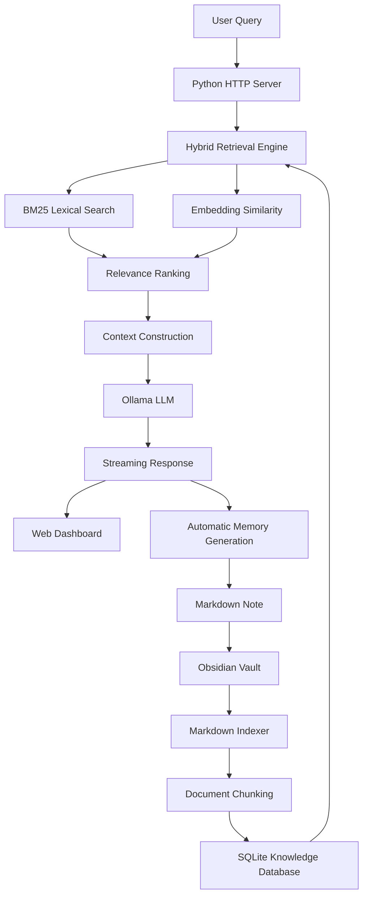

# Second Brain

### A self-growing, locally hosted AI knowledge system powered by Ollama, Python, and Obsidian.

Second Brain is a locally hosted AI knowledge engine that transforms an Obsidian vault into an intelligent, searchable memory system.

Built around Retrieval-Augmented Generation (RAG), it combines lexical search, semantic embeddings, and locally hosted LLM inference to retrieve relevant knowledge and generate context-aware responses.

Unlike conventional AI chat interfaces, Second Brain can continuously expand its own knowledge base by converting generated answers into .MDs.

---

## Features

### Hybrid Knowledge Retrieval

Second Brain implements a hybrid retrieval pipeline combining:

- BM25-style lexical retrieval for keyword-based relevance.
- Semantic embeddings for contextual similarity.
- Cosine similarity for comparing embedding vectors.
- Automatic ranking of retrieved knowledge chunks.
- Configurable retrieval of the top five relevant chunks.

This allows the system to retrieve information based on both textual relevance and semantic relationships.

### Self-Growing Memory

One of the core features is automatic knowledge persistence.

When enabled, every completed AI interaction can be converted into a structured Markdown note and stored directly inside the Obsidian vault.

Generated notes include:

- Original user query.
- AI-generated response.
- Automatic metadata and tags.
- Links to source notes retrieved during generation.

Notes are stored inside the `_brain/` directory.

This creates a continuously expanding knowledge base where previous interactions become accessible context for future queries.

### Local LLM Inference

Powered by [Ollama](https://ollama.com/), Second Brain supports locally hosted language models.

Features include:

- Dynamic model discovery.
- Streaming token generation.
- Configurable context windows.
- Inference performance tracking.
- Local model configuration.

The context window can be adjusted between 4,096 and 32,768 tokens through the dashboard.

### Obsidian Integration

Second Brain directly indexes an existing Obsidian vault.

Its indexing engine:

- Recursively discovers Markdown documents.
- Splits documents into manageable chunks.
- Generates embeddings for indexed content.
- Tracks file modification timestamps.
- Skips hidden directories.
- Removes stale entries when source files disappear.

The resulting knowledge index is maintained in a local SQLite database.

### Real-Time Performance Dashboard

The frontend provides a visual representation of the complete retrieval and inference pipeline.

Dashboard metrics include:

| Metric | Description |
|---|---|
| Context Used | Percentage of configured context capacity consumed |
| Tokens/sec | LLM generation throughput |
| Latency | Total request processing time |
| Prompt Tokens | Number of prompt tokens processed |
| Output Tokens | Number of generated tokens |
| Notes Hit | Number of retrieved knowledge chunks |

Additional functionality includes:

- Animated retrieval and inference visualization.
- Knowledge retrieval visualization.
- Historical inference statistics.
- Token throughput graph.
- Prompt/output token comparison.
- Automatic model discovery.
- Manual vault reindexing.

---

## Architecture

Second Brain uses a lightweight architecture built around Python's standard library, SQLite, Ollama, and a browser-based dashboard.



### Technology Stack

| Technology | Purpose |
|---|---|
| Python 3 | Backend and application server |
| Ollama | Local LLM inference |
| SQLite | Persistent knowledge and inference database |
| Obsidian | Markdown-based knowledge storage |
| HTML5 | Dashboard structure |
| CSS3 | Dashboard styling |
| JavaScript | Frontend logic and visualization |
| Canvas API | Animated pipeline and performance charts |
| Server-Sent Events | Streaming AI responses |
| Embeddings | Semantic knowledge retrieval |

**Dependency philosophy:** The Python backend uses only the Python standard library. No external Python packages are required.

---

## Retrieval Pipeline

The retrieval engine combines lexical and semantic relevance.

### 1. Document Indexing

Markdown documents are discovered recursively inside the configured Obsidian vault.

Documents are divided into chunks, with paragraphs grouped into approximately 900-character segments.

### 2. Embedding Generation

Each chunk is embedded using the configured Ollama embedding model.

The embedding input includes the original file path, allowing document identity to remain associated with its content.

### 3. Lexical Retrieval

The system calculates a BM25-style relevance score using:

- Term frequency.
- Inverse document frequency.
- Document length normalization.

### 4. Semantic Retrieval

The query is embedded and compared against stored document embeddings using cosine similarity.

### 5. Hybrid Ranking

Lexical and semantic scores are combined to rank candidate chunks.

The highest-ranking results are passed into the LLM context.

If embedding generation is unavailable, lexical retrieval remains operational.

---

## Installation

### Requirements

- Python 3.9+
- [Ollama](https://ollama.com/)
- [Obsidian](https://obsidian.md/)
- A locally available chat model.
- An existing Obsidian vault or an empty directory.

### 1. Clone the repository

```bash
git clone https://github.com/sweur/Second-Brain.git
cd Second-Brain
```

### 2. Install Ollama

Download and install Ollama:

https://ollama.com/

### 3. Download an LLM

For example:

```bash
ollama pull llama3.2
```

You can use another compatible Ollama chat model.

### 4. Download the embedding model (if you get HTTP error just pull any model you like.)

```bash
ollama pull nomic-embed-text
```

The default embedding model is `nomic-embed-text`.

### 5. Start Second Brain

```bash
python3 server.py /path/to/your/obsidian-vault
```

The server starts at:

```text
http://127.0.0.1:8787
```

Open that address in your browser.

The initial indexing process starts automatically.

---

## Configuration

Second Brain supports configuration through environment variables.

| Variable | Default | Description |
|---|---|---|
| `OLLAMA` | `http://127.0.0.1:11434` | Ollama API address |
| `EMBED_MODEL` | `nomic-embed-text` | Embedding model |
| `PORT` | `8787` | HTTP server port |
| `VAULT` | `~/vault` | Default Obsidian vault |

Example:

```bash
export OLLAMA=http://127.0.0.1:11434
export EMBED_MODEL=nomic-embed-text
export PORT=8787

python3 server.py ~/Documents/Obsidian
```

Alternatively, pass the vault directory directly as a command-line argument.

---

## Data Storage

Second Brain maintains two primary storage locations.

### Obsidian Vault

Your original Markdown documents remain in their existing locations.

Automatically generated AI memories are stored under:

```text
your-vault/
└── _brain/
    ├── 2026-01-01-1200-example-query.md
    └── ...
```

### SQLite Database

The backend maintains a local SQLite database:

```text
second-brain/
├── server.py
├── index.html
└── brain.db
```

The database contains two primary tables:

**`chunks`**

Stores indexed Markdown content, file modification timestamps, chunk positions, and serialized embeddings.

**`runs`**

Stores inference statistics, including:

- Timestamp.
- Model.
- Query.
- Prompt token count.
- Output token count.
- Context window.
- Generation speed.
- Request latency.
- Retrieved note count.

The dashboard uses this data to display historical performance.

---

## API

The backend exposes a small HTTP API.

| Method | Endpoint | Description |
|---|---|---|
| GET | `/` | Serves the web dashboard |
| GET | `/api/models` | Retrieves available Ollama models |
| GET | `/api/stats` | Retrieves historical inference statistics |
| POST | `/api/reindex` | Reindexes the Obsidian vault |
| POST | `/api/chat` | Executes a RAG-powered chat request |

### Chat Request

```json
{
  "model": "llama3.2",
  "q": "What do my notes say about distributed systems?",
  "ctx": 8192,
  "learn": true
}
```

The chat endpoint returns a Server-Sent Events-style stream containing retrieval events, generated tokens, completion statistics, and errors.

### Reindex Response

```json
{
  "updated": 12,
  "notes": 45,
  "chunks": 180,
  "embedded": 180
}
```

The values above are illustrative.

---

## Privacy & Security

Second Brain is designed around local execution.

- LLM inference is performed through Ollama.
- Knowledge is stored in a local SQLite database.
- Original documents remain in the local Obsidian vault.
- The backend uses Python's standard library.
- No external cloud AI provider is required.

The HTTP server binds to `127.0.0.1` by default, making it accessible through the local machine rather than exposing it to the network.

**Note:** Local execution does not automatically guarantee security. Keep the server and Ollama environment appropriately protected, particularly if modifying the network binding.

---

## Contributing

Contributions, bug reports, and feature suggestions are welcome. (AI-generated PRs are accepted.)

1. Fork the repository.
2. Create a feature branch.
3. Implement your changes.
4. Test the implementation.
5. Submit a Pull Request.

For larger architectural changes, open an issue to discuss the proposed implementation first.

---

## License

See the repository's `LICENSE` file for licensing information.

---

<p align="center">

</p>
